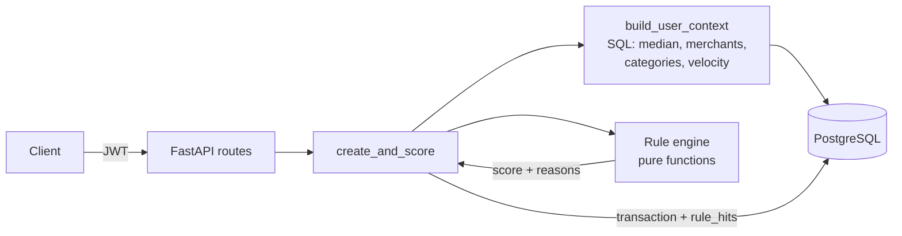

# Cardify Fraud API

[](https://github.com/Suzana121/cardify-fraud-api/actions/workflows/ci.yml)

A backend service that receives credit-card transactions, scores each one against **that user's own
spending history** with an explainable rule engine, and flags the suspicious ones, saying *why* each was flagged.

It rebuilds the core of my final project,
[Smart Credit Card Transaction Analysis](https://github.com/Suzana121/Smart-Credit-Card-Transaction-Analysis)
(Flask + Firebase + Isolation Forest), as a production-style service:
PostgreSQL instead of Firestore, migrations, JWT auth, automated tests, Docker, CI and cloud deployment.

**Live demo:** _add the Render URL here_ · interactive docs at `/docs`
(demo login: `demo@cardify.dev` / `demo-pass-123`)

## Tech stack

FastAPI · SQLAlchemy 2.0 · PostgreSQL 16 · Alembic · Pydantic v2 · JWT (PyJWT + bcrypt) ·
pytest · ruff · Docker · GitHub Actions · Render

## Architecture



1. `POST /transactions` converts the amount to ILS.
2. `build_user_context` asks Postgres what is normal for this user: median spend
   (`percentile_cont`), whether the merchant and category were seen before, and how many transactions
   arrived in the last 10 minutes. Transactions the user confirmed as fraud are excluded.
3. Every rule looks at the transaction plus that context. The scores of the rules that fired are
   summed, capped at 100, and a total of **≥ 50** (`FLAG_THRESHOLD`) marks the transaction `FLAGGED`.
4. The transaction is stored with one `rule_hits` row per reason, so every decision can be explained.

## Fraud rules

| Rule | Fires when | Score |
|---|---|---|
| `VELOCITY` | 5+ transactions within 10 minutes | 50 |
| `HIGH_AMOUNT_VS_MEDIAN` | amount > 5× the user's median spend | 40 |
| `LARGE_ABSOLUTE_AMOUNT` | amount > 10,000 ILS | 40 |
| `NEW_MERCHANT` | first time at this merchant (case-insensitive) | 20 |
| `FOREIGN_CURRENCY` | currency is not ILS | 15 |
| `RARE_CATEGORY` | category is < 1% of the user's history | 10 |

Rules that compare against history stay silent until the user has 5 transactions (no false alarms on cold start).
Adding a rule means writing one small class in [`app/fraud/rules.py`](app/fraud/rules.py) and adding it to `DEFAULT_RULES`.

## API

| Method | Path | Description |
|---|---|---|
| `POST` | `/auth/register` | Create an account |
| `POST` | `/auth/login` | OAuth2 password form → JWT access token |
| `GET` | `/auth/me` | Current user |
| `POST` | `/transactions` | Submit and score a transaction |
| `GET` | `/transactions?status=FLAGGED&limit=20&offset=0` | List your transactions |
| `GET` | `/transactions/{id}` | One transaction with its reasons |
| `PATCH` | `/transactions/{id}/review` | Confirm `legit` or `fraud` |
| `GET` | `/stats/summary` | Counts by status, flag rate, most common rules |
| `GET` | `/health` | Liveness + database check |

Users only ever see their own transactions. Another user's id returns 404.

```bash
curl -X POST localhost:8000/auth/login -d 'username=demo@cardify.dev&password=demo-pass-123'
# {"access_token": "eyJ...", "token_type": "bearer"}

curl -X POST localhost:8000/transactions \
  -H "Authorization: Bearer $TOKEN" -H 'Content-Type: application/json' \
  -d '{"merchant": "Overseas Shop", "amount": 2500, "currency": "USD", "category": "Other"}'
```

```json
{
  "id": 201, "merchant": "Overseas Shop", "amount": "2500.00", "currency": "USD",
  "amount_ils": "9250.00", "risk_score": 75, "status": "FLAGGED",
  "rule_hits": [
    {"rule_code": "HIGH_AMOUNT_VS_MEDIAN", "reason": "Amount is 99.1x your typical (median) spend", "score": 40},
    {"rule_code": "NEW_MERCHANT", "reason": "First transaction at this merchant", "score": 20},
    {"rule_code": "FOREIGN_CURRENCY", "reason": "Transaction in foreign currency (USD)", "score": 15}
  ]
}
```

## Run locally

Requires Docker Desktop.

```bash
docker compose up --build                            # API on http://localhost:8000/docs
docker compose exec api python -m scripts.seed       # demo user + 200 transactions
```

### Tests

The tests run against a real Postgres database (`cardify_test`, created by the compose setup) and
apply the real Alembic migrations first.

```bash
python3 -m venv .venv && source .venv/bin/activate
pip install -e ".[dev]"
docker compose up -d db
pytest --cov=app
ruff check . && ruff format --check .
```

## Deploy (Render)

[`render.yaml`](render.yaml) is a Render Blueprint: in Render choose **New → Blueprint**, pick this repo,
and it creates the web service (built from the Dockerfile) plus a Postgres database, with a generated `JWT_SECRET`.
Migrations run automatically on every start. With `SEED_DEMO=true` (set in the blueprint) the demo user and
its transactions are loaded on the first start; later starts skip it because the demo user already exists.

> Render's free Postgres expires after 30 days. For a long-lived demo, use a free [Neon](https://neon.tech)
> database instead and set its connection string as `DATABASE_URL`.

## Project layout

```
app/
  api/routes/      auth, transactions, stats
  core/            settings, password hashing, JWT
  db/              engine + session
  fraud/           context.py (SQL profile), rules.py, engine.py
  models/          SQLAlchemy models
  schemas/         Pydantic request/response models
  services/        currency conversion, create_and_score
alembic/           migrations
scripts/seed.py    demo data
tests/unit/        rules + engine, no database
tests/api/         end-to-end HTTP tests against Postgres
```

## Possible next steps

- Bring back the Isolation Forest model from the original project as one more rule (`ML_ANOMALY`)
- Bulk upload of bank statement files (Excel/CSV)
- Rate limiting and refresh tokens
